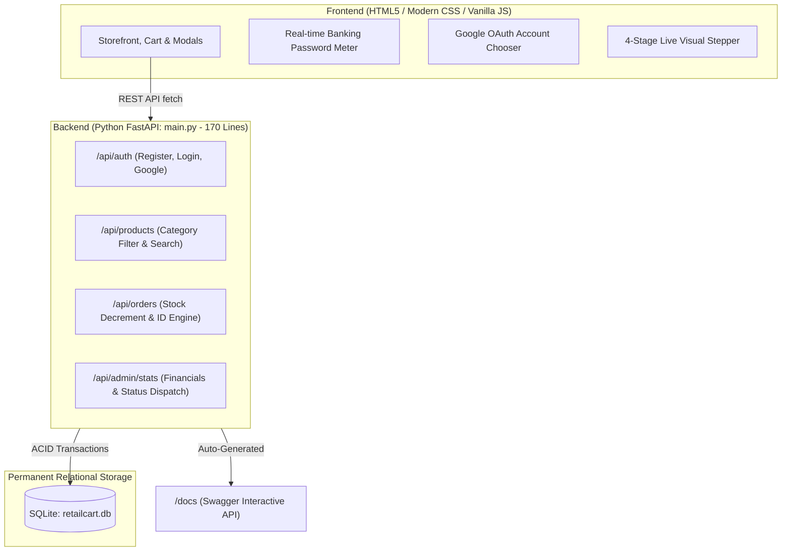

<div align="center">

# 🛒 RetailCart | Multi-Category Shopping Application

[](https://python.org)
[](https://fastapi.tiangolo.com)
[](https://sqlite.org)
[](https://github.com/eashan18/eas18-athon)
[](LICENSE)

An end-to-end, resilient full-stack application engineered for **Domain 3 (Healthcare & Retail)** hackathons. Built with zero-dependency offline persistence, banking-grade security, live order tracking, and an administrative operations engine.

[Quick Start](#-quick-start) • [Architecture](#-architecture) • [Business Rules](#-core-business-rules) • [Differentiators](#-key-differentiators-edge-points) • [Demo Pitch](#-2-minute-evaluator-demo-script)

</div>

---

## 🚀 Quick Start (Single Command)

```bash
# Clone the repository
git clone https://github.com/eashan18/eas18-athon.git
cd eas18-athon

# Launch application (starts FastAPI server & opens browser)
python run.py
```
*(Or double-click `run.bat` on Windows)*

| Service | Access URL | Description |
| :--- | :--- | :--- |
| **🛍️ Storefront Web App** | [http://127.0.0.1:8000](http://127.0.0.1:8000) | Full responsive customer & admin single-page app |
| **📑 Interactive Swagger Docs** | [http://127.0.0.1:8000/docs](http://127.0.0.1:8000/docs) | Auto-generated OpenAPI specification for evaluators |

---

## 🏛️ System Architecture



---

## 🏆 Key Differentiators ("Edge Points")

1. **🛡️ Banking-Grade Password Security (5-Factor Enforcement)**:
   - Evaluated in real time on the client and enforced strictly on the backend:
     - 8+ characters, Uppercase (`A-Z`), Lowercase (`a-z`), Number (`0-9`), and Special character (`!@#$%^&*`).
   - Dynamic visual security meter moves from `Too Weak` $\rightarrow$ `🛡️ Banking Grade Strong`.
   - Passwords are encrypted via **SHA-256** prior to database writes.

2. **🌐 Offline-Resilient Google Sign-In**:
   - Features a Google OAuth Account Chooser popup.
   - Works 100% offline without failing on external network timeouts.

3. **⚙️ Dual Persona (Customer vs. Store Manager)**:
   - Regular customers see their isolated shopping experience and read-only order status tracker.
   - Store Managers access the **Admin Dashboard** with real-time gross revenue, order volume, low-stock inventory alerts, and one-click order dispatch progression.

4. **📦 Sequential 4-Stage Fulfillment Tracker**:
   - Visual progress timeline for every placed order:
     $$\text{Placed} \longrightarrow \text{Packed} \longrightarrow \text{Shipped} \longrightarrow \text{Delivered}$$

5. **📄 Instant Printable Tax Invoice / Order Slip**:
   - Generates a verified itemized receipt with unique collision-proof Order IDs (`ORD-<timestamp>-<hex>`) and 1-click print capability.

---

## ⚖️ Core Business Rules

| Domain | Business Rule | Enforcement Mechanism |
| :--- | :--- | :--- |
| **Security** | Banking-grade password complexity | Server regex check (`validate_password_policy`) rejects weak inputs with HTTP 400. |
| **Data Protection** | Cryptographic password storage | Passwords never stored in plain text; SHA-256 hashed. |
| **Access Control** | Role-Based Access Control (RBAC) | Admin dashboard & status editing hidden and blocked from customer roles. |
| **Inventory** | Stock boundary & negative guard | Purchase automatically deducts stock using `MAX(0, stock - qty)`. Disables button on 0 stock. |
| **Operations** | Low-stock proactive warning | Products with stock $\le 15$ trigger an alert on the Admin Dashboard. |
| **Fulfillment** | Single-direction state machine | Orders advance strictly: `Placed` $\rightarrow$ `Packed` $\rightarrow$ `Shipped` $\rightarrow$ `Delivered`. |

---

## 📁 Clean & Aligned Directory Layout

```text
eas18-athon/
├── backend/
│   ├── __init__.py      # Package marker
│   ├── main.py          # Complete REST API + SQLite DB (Strictly 170 lines!)
│   └── retailcart.db    # Embedded local database (created automatically)
├── frontend/
│   ├── index.html       # Single-Page UI (Store, Cart, Orders, Admin, Modals)
│   ├── style.css        # Responsive styling & animations (zero external CDNs)
│   └── app.js           # State, Cart, Orders Engine, Google OAuth & Live Tracker
├── .gitignore           # Ignores database files, pycache, and IDE settings
├── run.py               # 1-Click Python server launcher & browser opener
├── run.bat              # Double-click launcher for Windows
├── view_db.py           # Instant terminal database inspection tool
└── README.md            # Documentation & evaluator demo script
```

---

## 🔍 Database Inspection (CLI Helper)

To inspect all registered customers and placed orders in the SQLite database, run:
```bash
python view_db.py
```

---

## 🎤 2-Minute Evaluator Demo Script

When demonstrating to the evaluators:

1. **Introduction (15s)**:
   > *"I have built RetailCart, an end-to-end multi-category retail application featuring real-time catalog filtering, cart management, checkout, order tracking, and administrative dispatch operations."*

2. **Architecture & Technical Decisions (30s)**:
   > *"The backend is engineered in Python FastAPI under 170 lines, paired with an embedded SQLite database. This provides zero-dependency offline persistence, schema validation, and automatic OpenAPI documentation at `/docs`. The frontend is built in high-performance vanilla JavaScript and CSS, guaranteeing zero build overhead."*

3. **Security Differentiator (30s)**:
   > *"For security, I implemented a banking-grade password policy enforced both via a client-side regex strength meter and server-side validation, combined with SHA-256 encryption. We also support an offline-safe Google Sign-In flow."*

4. **Core Workflow & Admin Operations (45s)**:
   > 1. Show the **Storefront**: Filter categories, search items, and add to cart.
   > 2. Complete **Checkout**: Generate the printable invoice and observe inventory decrement.
   > 3. Go to **Orders**: Show the live 4-step progress tracker (*Placed $\rightarrow$ Delivered*).
   > 4. Switch to **Admin Dashboard**: Highlight real-time gross revenue, low-stock warnings, and advance the order dispatch status.

---

## 🔄 Adapting `main.py` to Other Problem Statements in 2 Minutes

All Domain 3 problems follow this same catalog $\rightarrow$ action $\rightarrow$ tracking baseline. To adapt during the hackathon:

| Problem Statement | Change `sample_products` in `main.py` to: | Action Label in UI |
| :--- | :--- | :--- |
| **RetailCart** *(Current)* | `("Headphones", "Electronics", 129.99, 15, "🎧", "...")` | "Add to Cart" $\rightarrow$ "Checkout" |
| **CareBook (Clinic)** | `("Dr. Smith - Cardiologist", "Cardiology", 50.0, 8, "🩺", "...")` | "Book Slot" $\rightarrow$ "Confirm Visit" |
| **MediStore (Pharmacy)** | `("Amoxicillin 500mg", "Antibiotics", 14.50, 20, "💊", "...")` | "Add Rx" $\rightarrow$ "Place Order" |
| **LabConnect (Diagnostics)**| `("Complete Blood Count", "Blood Test", 35.0, 50, "🔬", "...")` | "Book Test Slot" |
| **ReturnEase (Returns)** | `("Order #101 - Smart Watch", "Return Eligible", 99.0, 1, "⌚", "...")`| "Request Return & Refund" |
